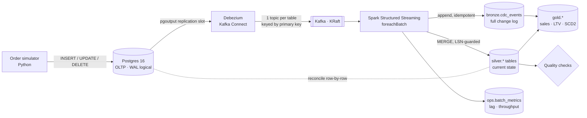

# Real-Time Order Replication with Change Data Capture

Stream every insert, update and delete from an e-commerce Postgres database into an
Apache Iceberg lakehouse within seconds, using **Debezium**, **Kafka** and
**Spark Structured Streaming**, and *prove* the copy is exact with automated row-level
reconciliation and data quality checks.

Runs entirely on your laptop with Docker. Cost: **$0**.

---

## The problem

Analytics teams need fresh order data, but running reports against the production
database slows down checkout, and nightly full dumps are hours stale, miss rows that
were deleted, and get slower as tables grow.

**Change Data Capture (CDC)** solves this by reading the database's write-ahead log
(WAL): every committed change is streamed out as an event, with no extra load on the
application tables. This is how companies like Netflix, Shopify and Airbnb feed their
lakehouses.

## Results (local run, October 2026)

About 40 minutes of continuous traffic on a laptop (Docker Desktop, 6 GB):

| Metric | Result |
|---|---|
| Change events streamed | **50,279** (38,119 inserts · 10,548 updates · 1,612 deletes) over 238 micro-batches |
| End-to-end latency (Postgres commit → Iceberg row) | **p50 6.6 s · p95 8.7 s** |
| Row-level reconciliation vs. Postgres | **37,141 / 37,141 rows matched**, 0 mismatched, 0 missing, 0 extra |
| Data quality checks | **15 / 15 passed** |
| Chaos drill (SIGKILL Spark mid-batch + restart Debezium, traffic flowing) | **39,172 / 39,172 rows matched** afterwards, all 15 checks passed |
| Micro-batch time before → after Iceberg compaction | **~7 s → ~4.5 s** |

**What the run taught me**

- **Small files are real.** With merge-on-read, every 10-second MERGE adds small data
  files, delete files and a snapshot, and batch time crept from ~4 s to ~7.5 s over 30
  minutes. Compaction plus snapshot expiry brought it back to ~4.5 s.
- **Compaction and streaming writes conflict.** The first maintenance attempt ran while
  the stream was writing; Iceberg's optimistic concurrency rejected the compaction commits
  (safely, nothing was corrupted, but nothing was compacted either). `make maintenance`
  now pauses the streamer, compacts, and resumes. Kafka buffers the changes, and the
  first batch afterwards caught up 731 events in 5.7 s.
- **Iceberg `CALL` procedures only take literal arguments**, so the snapshot-expiry
  cut-off timestamp is computed in Python rather than with `current_timestamp() - INTERVAL`.

## Architecture



| Layer | Tables | Purpose |
|---|---|---|
| **Bronze** | `lake.bronze.cdc_events` | Immutable log of every change event. Replayable, auditable. |
| **Silver** | `lake.silver.customers / products / orders / order_items` | Exact current-state mirror of Postgres (inserts, updates, **hard deletes**). |
| **Gold** | `daily_sales`, `product_performance`, `customer_ltv`, `dim_customer_history` | Business tables, including an **SCD Type 2** customer dimension rebuilt from the change log. |
| **Ops** | `lake.ops.batch_metrics` | Per-batch event counts and end-to-end latency. |

## Tech stack

| Skill employers list | Where it's used here |
|---|---|
| Python, SQL | Simulator, Spark jobs, all transformations and checks |
| Apache Kafka | Event backbone (KRaft mode, no ZooKeeper) |
| Streaming / real-time | Spark Structured Streaming with checkpointing |
| CDC | Debezium Postgres connector, logical replication |
| Apache Spark | Streaming MERGE, batch gold jobs, JDBC reconciliation |
| Lakehouse / open table formats | Apache Iceberg v2: MERGE, time travel, compaction |
| Data modeling | Medallion layers, SCD Type 2 dimension |
| Data quality | Reconciliation + rule-based checks that fail the build |
| Docker | Whole platform in one `docker compose up` |
| CI/CD, testing | GitHub Actions: lint, 26 unit tests, full end-to-end run |

## Quickstart

**Prerequisites:** Docker Desktop with **at least 6 GB RAM** allocated, and `make`.
Host ports used: 5434 (Postgres), 29092 (Kafka), 8083 (Kafka Connect), 8085 (Kafka UI), 4040 (Spark UI).
(Windows: use WSL2.)

```bash
make up          # builds and starts Postgres, Kafka, Debezium, the simulator and the streamer
make logs        # watch micro-batches: "batch 12: 96 events (c=40 u=51 d=5 r=0) lag=4.2s"
```

The first start downloads Spark/Iceberg jars, so give the streamer 2–3 minutes.

| UI | URL |
|---|---|
| Kafka UI (topics, messages, connector) | http://localhost:8085 |
| Spark UI (streaming query progress) | http://localhost:4040 |

## Demo script (≈10 minutes)

```bash
make up                 # 1. start everything, let it run a few minutes
make connector          # 2. Debezium connector is RUNNING
make pause              # 3. stop new traffic
make reconcile          # 4. Postgres vs lake, row by row -> RECONCILIATION PASS
make quality            # 5. 15 data quality checks -> QUALITY PASS
make gold               # 6. build gold tables, see SCD2 history of customers who moved
make stats              # 7. throughput, p50/p95 latency, time travel demo
make resume             #    restart traffic
make chaos              # 8. kill Spark mid-batch + restart Debezium, then reconcile again
```

`make chaos` is the strongest thing to show an interviewer: it hard-kills the
streaming job and restarts Kafka Connect while orders keep flowing, then proves no
row was lost, duplicated or left stale.

Reconciliation output from a real run:

```
table             source   matched  mismatch   missing     extra
customers           1872      1872         0         0         0
products              60        60         0         0         0
orders             10077     10077         0         0         0
order_items        25132     25132         0         0         0

RECONCILIATION PASS
```

## Design decisions

**1. Why CDC instead of polling `WHERE updated_at > last_run`?**
Polling misses hard deletes, misses rows whose `updated_at` isn't maintained, and
puts query load on production. Reading the WAL captures every committed change, in
commit order, with near-zero load on the source.

**2. How do you get exactly-once results from at-least-once delivery?**
Kafka + Spark give *at-least-once*: after a crash, the last micro-batch is replayed.
The sinks are made idempotent instead:
- **Bronze**: each append is tagged with a hash of the batch's Kafka offset ranges as an
  Iceberg snapshot property. A replayed batch finds its tag and skips the write.
- **Silver**: `MERGE ... WHEN MATCHED AND s._lsn >= t._lsn`. Re-applying an old change
  can never overwrite a newer row, because Postgres LSNs only increase.

**3. How is ordering guaranteed?**
Debezium keys each message by primary key, so all changes to one row go to the same
Kafka partition in commit order. Inside a micro-batch, only the latest change per key is
kept (`row_number()` over LSN, then Kafka offset). MERGE requires one source row per
target row anyway.

**4. How are deletes handled?**
`REPLICA IDENTITY FULL` makes Postgres log the full old row, Debezium emits `op = d`
with a `before` image, and the MERGE issues a real `DELETE`. Silver mirrors the source
exactly. The bronze log still keeps the history.

**5. Why merge-on-read, and what's the cost?**
Copy-on-write would rewrite whole data files on every 10-second batch. Merge-on-read
writes small delete files instead, so writes are cheap, but reads slow down as delete
files pile up. `make maintenance` pauses the streamer, compacts data files, rewrites
delete files, expires old snapshots and resumes (see Results for the measured effect).

**6. What can still go wrong?** (shows maturity)
- *Transaction boundaries*: an order and its items are separate topics, so for a few
  seconds the lake may show an order before its items. The `orders.total_matches_items`
  check catches a permanently partial transaction.
- *Schema evolution*: JSON without a schema registry means a renamed column breaks
  parsing. The production answer is Avro + Schema Registry (see Next steps).
- *Replication slot growth*: if the connector is down for days, Postgres keeps WAL
  for the slot and the disk fills. Monitor slot lag in production.

## Testing

```bash
pip install -r requirements-dev.txt   # Python 3.11 + Java 17 needed for local Spark
make lint test                        # ruff + 26 pytest tests, no Docker needed
make e2e                              # full stack: 1,500 transactions -> reconcile + quality must pass
```

Unit tests cover envelope parsing, delete handling, latest-change-per-key logic,
LSN tie-breaking, the MERGE statement, reconciliation classification, every gold
query (including SCD2 versioning) and the quality rules. GitHub Actions runs lint and
unit tests on every push, and the full end-to-end pipeline on `main`.

## Project structure

```
├── docker-compose.yml          # Postgres, Kafka, Debezium, Kafka UI, simulator, streamer
├── Dockerfile                  # Python 3.11 + Java 17 + PySpark (one image for all jobs)
├── postgres/init.sql           # source schema (REPLICA IDENTITY FULL)
├── debezium/                   # connector config
├── simulator/                  # realistic order traffic (rules.py is unit-tested)
├── pipeline/
│   ├── tables.py               # single source of truth for tables, keys, types
│   ├── cdc.py                  # parsing, dedup, MERGE SQL (pure, tested)
│   └── spark_session.py        # Spark + Iceberg + Kafka config
├── jobs/
│   ├── stream_cdc_to_iceberg.py
│   ├── reconcile.py            # row-level Postgres vs lake comparison
│   ├── quality_checks.py
│   ├── build_gold.py           # gold tables + SCD2
│   ├── maintenance.py          # compaction, snapshot expiry
│   └── pipeline_stats.py       # numbers for your resume
├── scripts/                    # connector registration, e2e test, chaos drill
├── tests/                      # pytest with local Spark
└── .github/workflows/          # CI + end-to-end pipeline test
```

## Next steps (ideas to extend it)

- **Avro + Confluent Schema Registry** for safe schema evolution
- **Trino** as a SQL engine over the Iceberg tables, plus a Superset dashboard
- **MinIO** (S3-compatible) instead of a local volume for the warehouse
- **Airflow** to schedule `gold`, `quality`, `reconcile` and `maintenance`
- **Dead-letter topic** for events that fail parsing
- **Terraform** to deploy the same design to AWS (MSK, EMR, S3, Glue catalog)

## Troubleshooting

| Symptom | Fix |
|---|---|
| Streamer restarts / `OutOfMemoryError` | Give Docker more RAM (6–8 GB). |
| `make connector` shows `FAILED` | `docker compose logs connect`; usually Postgres wasn't ready. Re-run `docker compose up -d register-connector`. |
| Reconcile shows `missing_in_lake` while traffic runs | Expected lag. Run `make pause` first; the job also retries. |
| Start completely fresh | `make clean && make up` |
